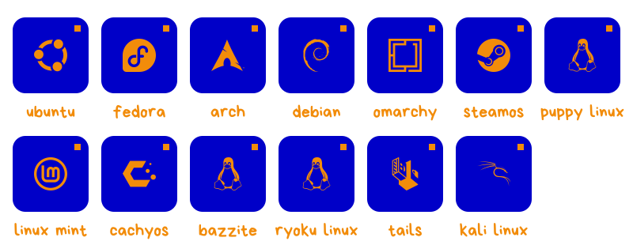

i make small software things and spend too much time on the details.

## projects

**[pixel diary](https://github.com/fordpepper/pixeldiary)**
a mood diary where every day is a little pixel art picture. it lives on your computer, stores everything as plain text, and runs without installing anything extra.

**[vapourarch](https://github.com/fordpepper/vapourarch)**
my own take on a portable linux: arch with a gnome desktop that boots from a usb stick, with an app that copies itself onto the next one. still a work in progress.

## elsewhere

i mostly tinker on whatever i'm curious about that week, so the rest of my repos are a bit of a mix.

## distros i've used

